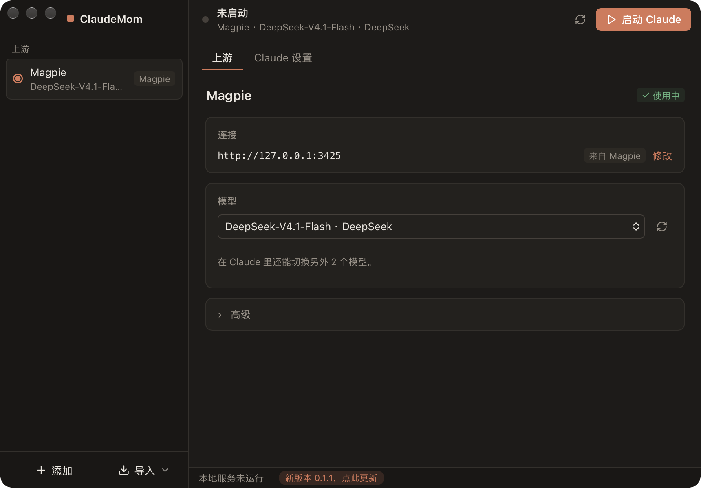
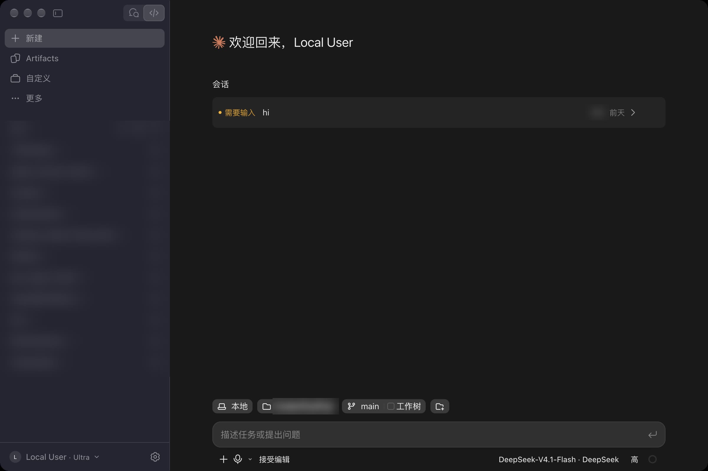

# ClaudeMom

**不用 Claude 账号！把 API Key 变成登录模式，Claude 桌面版全功能解锁（汉化 / 语音 / 电脑控制）**


Claude 桌面版一直有两种用法：

- **登录官方账号**：完整功能，Chat / Code / Cowork、电脑控制、语音输入都在
- **填 API Key（第三方 / 3p 模式）**：能用，但很多功能入口直接没了

ClaudeMom 是一种**新的接入方式**：在本机把你的 API Key **变成「登录模式」**。Claude 桌面版看到的是一个已登录的账号，界面和功能都是登录版的；实际的模型请求走你自己的 Base URL + Key。

不需要 Claude 账号，不改原版应用，不动官方登录态，官方 App 照常更新。

下载：[Releases](https://github.com/BigPizzaV3/ClaudeMom/releases/latest)（macOS 通用版 dmg / Windows exe）

友情链接：<a href="https://linux.do">LINUX DO</a>

## 三种接入方式对比

| | 登录官方账号 | API Key（3p 模式） | **ClaudeMom** |
|---|---|---|---|
| 需要 Claude 账号 | 要 | 不要 | **不要** |
| 模型来源 | 官方 | 你的 Key | **你的 Key** |
| Chat / Code / Cowork | ✅ | 部分 | **✅** |
| 电脑控制 / 语音输入 | ✅ | ❌ | **✅** |
| 中文界面 | ✅ 但是不敢开 | ❌ | **✅** |

## 原理

本地起一个兼容服务，接管 Claude 桌面版的账号和功能请求：账号信息、功能开关按「已登录」返回，对话请求转发到你配置的上游。证书只在本机生效，随时可以取消信任。

## 功能

- **登录模式体验**：Chat / Code / Cowork 三个页签都能用，是原版客户端，不是网页套壳
- **多组上游**：每组一个 Base URL + Key（Anthropic 兼容，和 `ANTHROPIC_BASE_URL` 同语义），随时切换，可拉取模型列表
- **一键导入**：cc-switch 的 Claude 供应商；也可以把 Magpie 的本机网关当上游
- **界面汉化**：完整中文界面
- **语音输入**：本地离线听写（SenseVoice），音频不出本机
- **电脑控制 / 后台模式**：较新的 macOS 上 Claude 会提示「暂不支持后台模式」，高级里有开关可以解除版本限制（默认关）
- **Code 页签和命令行共用 `~/.claude`**：终端、其他工具里建的 Claude Code 会话也会出现在 Desktop 左侧列表
- **自动更新**；macOS 版已签名 + 公证，下载即可打开





## 使用

1. 先装好官方 Claude Desktop 和 Node.js 22+
2. 打开 ClaudeMom，第一次按提示信任本地证书（只在本机生效）
3. 添加上游（或从 cc-switch 导入），选默认模型
4. 点「启动 Claude」，进去就是登录版界面

欢迎提 issue 和 PR，一起把 Claude 桌面版用得更顺手！

## 结构

| 目录 | 说明 |
|---|---|
| `crates/claude-local` | 核心：本地兼容服务（`runtime/`）、证书、profile 切换、启动 / 停止、听写。 |
| `apps/claude-mom` | ClaudeMom 桌面程序（Tauri + React）。 |

## 开发

```bash
cd apps/claude-mom
npm install
npm run check && npm test          # 前端
cargo test --workspace             # Rust（在仓库根目录）
npx tauri build --bundles app      # 打包 macOS .app
node scripts/relaunch-local.mjs    # 构建并重启本地实例（在仓库根目录）
```

核心的 Node 测试：`cd crates/claude-local/runtime && node --test managed.test.mjs proxy.test.mjs`
（需要本地测试证书：`scripts/gen-ca.sh`）。

## 许可

AGPL-3.0-only
